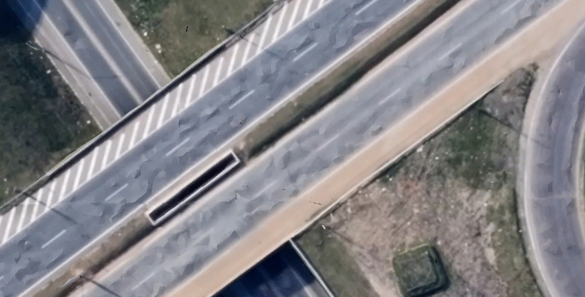
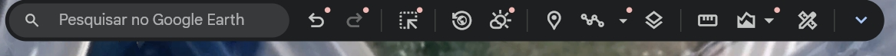
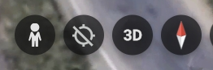
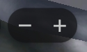

# Análise Forense do Terravision por Nicolas

  
# *** \\\ || // *** // *** // *** || * || *** \\\ *** \\\ *** \\\ || // ***

## 1. Processamento e Tratamento de Imagem:
#### Quais desafios de "costura" de imagem (stitching), ajuste de textura ou uniformização de cor o algoritmo enfrenta
#### ao renderizar especificamente o seu tipo de terreno (Ex.: reflexo da luz na água, falta de contraste no gelo, sombra
#### de montanhas ou densidade de prédios)?

###### R: Quando se olha para as rodoviárias de perto é possível ver uma certa dificuldade em carregar a imagem de modo suave

###### Provavelmente "culpa" da IA que tenta melhorar a qualidade da imagem mas acaba deixando ela como essa "massa"

## 2. Design de Interface e Leis da Gestalt:
#### Identifique pelo menos duas Leis da Gestalt (Figura-Fundo, Continuidade, Proximidade, Fechamento, etc.)
#### presentes na interface do usuário.

###### R: Uma das leis da Gestalt que o Google Earth segue é a lei da proximidade, deixando botões com mesmo estilo e cor para destaca-los como sendo do mesmo grupo

###### Outra lei também utilizada é a Lei da Pregnância ao separar os elementos de jeito simples, estático e simétrico

#### Explique como o design gráfico orienta a atenção do usuário e facilita a navegação intuitiva quando ele tenta aproximar o zoom exatamente no elemento do seu tema.

###### R: O Google Earth tem uma navegação bem suave e fácil de usar, tendo botões no canto inferior esquerdo para aumentar e diminuir o zoom e podendo ampliar o foco do mapa ao pressionar duas vezes o botão direito do mouse.

### Histórico de Commits
14/10/2026 - 1° Commit - Edição do README.md, adicionando o esqueleto do arquivo.

12/11/2026 - 2° Commit - Após muitos testes sem relatar neste arquivo, a parte inicial do programa está pronta, sendo agora preciso polir a interface gráfica. Adições ao script incluem:  
Parte lateral com os controladores de altitude;  
Troca de imagens baseado em botões;  
Preenchimento da imagem baseado no tamanho da janela da aplicação.

16/11/2026 - 3° Commit - Adição do projeto completo do programa, imagens necessárias para o uso do arquivo python e da customização do readMe;  
Respostas para as perguntas a respeito da interface e UX (Experiência do Usuário) do Google Earth.
